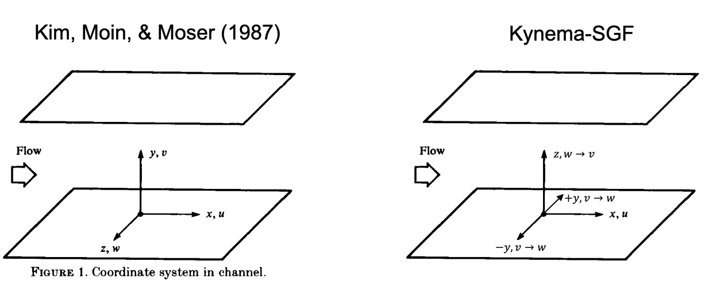
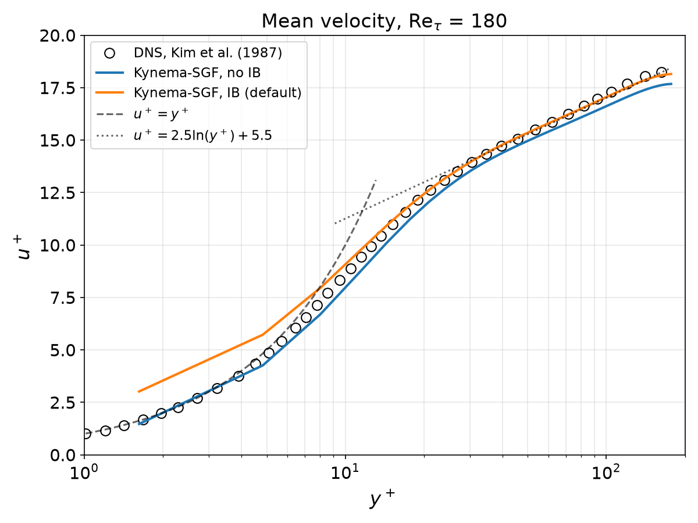
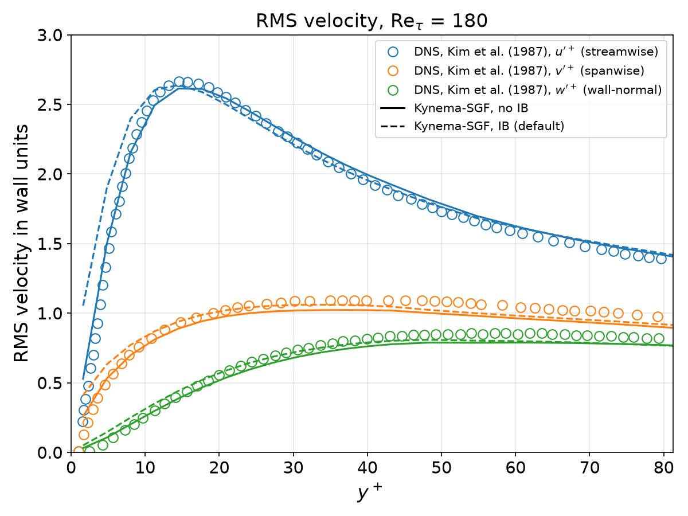

<!-- This file is compiled into the website through .website_src. -->

# Turbulent channel flow with immersed boundaries

This validation case compares wall-resolved large-eddy simulations (LES) of
pressure-driven turbulent channel flow with direct numerical simulation (DNS)
data at friction Reynolds numbers $Re_\tau = 180$ and $Re_\tau = 395$. The
channel walls are represented with `ChannelBuilder` immersed boundaries (IB)
and the `DragForcing` wall model. A channel with no-slip domain walls and no
IB provides a solver reference at $Re_\tau = 180$.

## Contents

- [Channel configurations](#channel-configurations)
- [Validation matrix](#validation-matrix)
- [Reference data](#reference-data)
- [Statistics](#statistics)
- [Prerequisites](#prerequisites)
- [Run the solver](#run-the-solver)
- [Analyze statistics](#analyze-statistics)
- [Check convergence](#check-convergence)
- [Outputs](#outputs)
- [Results](#results)

## Channel configurations

Flow is in the $x$ direction, $y$ is spanwise, and $z$ is wall-normal. The
DNS coordinate system uses $y$ as the wall-normal direction and $z$ as the
spanwise direction, so the DNS $v$ and $w$ components correspond to the
Kynema-SGF $w$ and $v$ components, respectively.



The walls are located at $z = \pm\delta$, where $\delta$ is the channel
half-height. The domain is periodic in $x$ and $y$. In the no-IB case, the
walls are the no-slip domain boundaries at $z = \pm\delta$. In the IB cases,
the domain is extended in $z$ and the `ChannelBuilder` walls at
$z = \pm\delta$ coincide with level 0 cell faces. Flow is driven by a uniform
body force 

$$f_{b,x} = -\frac{1}{\rho}\frac{dp}{dx}.$$

The fluid is air at 101325 Pa and 750 K:

| Property | Value |
| --- | --- |
| Density, $\rho$ | 0.468793 kg/m$^3$ |
| Dynamic viscosity, $\mu$ | 3.57816e-5 Pa s |
| Subgrid model | Smagorinsky, $C_s = 0.1$ |

The flow characteristics follow from:

$$u_\tau = Re_\tau\,\mu / (\rho\,\delta),$$
$$\frac{dp}{dx} = -\rho u_\tau^2 / \delta,$$
$$t^* = \delta / u_\tau.$$

| Quantity | $Re_\tau = 180$ | $Re_\tau = 395$ |
| --- | --- | --- |
| Half-height, $\delta$ | 0.005 m | 0.01 m |
| Domain, $L_x \times L_y$ | $6.24\delta \times 3.12\delta$ | $6.24\delta \times 3.12\delta$ |
| Friction velocity, $u_\tau$ | 2.7478 m/s | 3.0149 m/s |
| Pressure gradient, $dp/dx$ | -709.79 Pa/m | -426.121 Pa/m |
| Body force | 1514.08 m/s$^2$ | 908.975 m/s$^2$ |
| Viscous time, $t^*$ | 1.8197e-3 s | 3.3168e-3 s |
| Spin-up | $40t^*$ (0.072788 s) | $70t^*$ (0.232176 s) |
| Statistics | $10t^*$ (to 0.090985 s) | $10t^*$ (to 0.265344 s) |

Each mesh uses one level of refinement near each wall. Grid spacing in wall
units is:

| Mesh | $Re_\tau = 180$ | $Re_\tau = 395$ |
| --- | --- | --- |
| Level 0 cells, no IB | $192 \times 96 \times 56$ | N/A |
| Level 0 cells, IB | $192 \times 96 \times 64$ | $200 \times 96 \times 72$ |
| Level 0 $\Delta x^+, \Delta y^+, \Delta z^+$ | 5.85, 5.85, 6.43 | 12.32, 12.84, 12.34 |
| Level 1 $\Delta x^+, \Delta y^+, \Delta z^+$ | 2.93, 2.93, 3.21 | 6.16, 6.42, 6.17 |
| Level 1 extent from each wall | $z^+ \leq 45$ | $z^+ \leq 111$ |

In the IB cases, level 1 also covers the solid cells between the wall and the
domain boundary.

## Validation matrix

| Case | $Re_\tau$ | Walls | Directory |
| --- | --- | --- | --- |
| No IB | 180 | No-slip domain boundaries | `cases/re180-no-ib` |
| IB (`default`) | 180 | `ChannelBuilder` with `DragForcing` | `cases/re180-default` |
| IB (`default`) | 395 | `ChannelBuilder` with `DragForcing` | `cases/re395-default` |

The `default` IB configuration uses the current `DragForcing` implementation,
with `ABL.surface_roughness_z0 = 0.00001`. The $Re_\tau = 395$ employs a wall model by setting `ChannelBuilder.initialize_drag_cells = true`.

Shared solver settings are in `cases/base.inp`. Each case directory contains:

- `inputs.inp`, which includes `base.inp` and sets the domain, forcing, walls,
  mesh, stop time, and the plane sampler used to collect statistics. Sampling
  starts after the spin-up time through `sampling.output_time_delay`.

## Reference data

The reference data in `data/` are DNS profiles from:

- $Re_\tau = 180$: Kim, J., Moin, P., and Moser, R. (1987). Turbulence
  statistics in fully developed channel flow at low Reynolds number.
  *Journal of Fluid Mechanics*, 177, 133-166.
- $Re_\tau = 395$: Moser, R. D., Kim, J., and Mansour, N. N. (1999). Direct
  numerical simulation of turbulent channel flow up to $Re_\tau = 590$.
  *Physics of Fluids*, 11(4), 943-945.

`Re<Re_tau>_MeanVelocity.csv` contains $u^+$ versus $y^+$. The
`Re<Re_tau>_RMS_<component>.csv` files contain RMS velocity in wall units
using the Kynema-SGF orientation: `U` is streamwise, `V` is spanwise, and
`W` is wall-normal.

## Statistics

The `channel_stats` plane sampler writes velocity on planes parallel to the
walls every $0.1t^*$ (`sampling.output_time_interval`), starting at the end of
the spin-up (`sampling.output_time_delay`). This gives 100 samples over the
$10t^*$ statistics window after a $40t^*$ ($Re_\tau = 180$) or $70t^*$
($Re_\tau = 395$) spinup. The planes are located at level 1 and level 0 cell
centers between $z = -\delta$ and $z = \delta$.

For each plane, the analyzer accumulates the sample count, sum, and sum of
squares of each velocity component over all sampled points and all sampler
outputs. It combines planes with the same distance from the nearest wall,
$y = \delta - |z|$, and computes

$$
\langle u_i \rangle = \frac{1}{N}\sum u_i,
\qquad
u_{i,\mathrm{rms}} = \sqrt{\frac{1}{N}\sum u_i^2 - \langle u_i \rangle^2}.
$$

Profiles are scaled with 
$$y^+ = \rho u_\tau y / \mu,$$
$$u^+ = \langle u \rangle / u_\tau,$$
$$u_{i,\mathrm{rms}}^+ = u_{i,\mathrm{rms}} / u_\tau.$$

By default, the friction velocity is computed from the imposed pressure gradient,

$$
u_\tau = \sqrt{-\frac{\delta}{\rho}\frac{dp}{dx}}.
$$

With `--utau-source gradU`, it is instead computed from the wall shear stress
$\tau_w = \mu\,|dU/dy|_{y=0}$, where the wall gradient comes from a quadratic
fit through the wall and the two planes nearest to it:

$$
\left.\frac{dU}{dy}\right|_{y=0} = \frac{U_0 y_1^2 - U_1 y_0^2}{y_0 y_1 (y_1 - y_0)},
\qquad
u_\tau = \sqrt{\tau_w / \rho}.
$$

## Prerequisites

Use the `kynema-sgf-env` conda environment shared by the immersed boundary
cases. It contains the Python, NumPy, and Matplotlib dependencies required by
the analyzer.

From this directory, create the environment when necessary and activate it:

```bash
conda env create -f ../kynema-sgf-env.yml
conda activate kynema-sgf-env
```

An available Kynema-SGF executable is also required. Solver launch and
resource selection are controlled by the user or the target HPC system.

## Run the solver

Each case runs in a single job from its case directory. The run spins up the
turbulence from a perturbed initial condition and then continues to the stop
time; the sampler begins writing statistics data at the end of the spin-up.
For example:

```bash
cd cases/re180-default
srun -N 2 --ntasks-per-node=50 kynema_sgf inputs.inp
```

The run writes sampler outputs in `post_processing/sampling*/`. Samples taken
before the spin-up time are not written.

## Analyze statistics

After the runs complete, run from this directory:

```bash
python python/analyze.py
```

The analyzer reads every completed sampler output in each case's
`post_processing/` directory with a particle reader adapted from
Kynema-SGF's `tools/amrex_particle.py`. Cases without sampler output are
reported and skipped. The time-averaged statistics on each sampling plane are
written to `cases/<case>/particle_stats.txt`; when that file exists, it is read
instead of the sampler output. Delete it to reprocess the sampler output, for
example after rerunning a case. Options:

- `--cases re180-no-ib,re180-default` analyzes a subset of cases.
- `--utau-source gradU` computes $u_\tau$ from the wall velocity gradient.
- `--output-dir PATH` changes the output directory.
- `--last-time` uses only the latest sampler output, for debugging. It does not
  read or write `particle_stats.txt`, and adds a `_last-time` suffix to the
  output file names.

## Check convergence

Statistics are only meaningful once the flow has reached a statistically
steady state. If the spin-up is too short, the bulk velocity is still changing
during the statistics window and the time averages are biased. Check this with:

```bash
python python/drift.py --nprocs 16
```

For each case, `drift.py` integrates the plane-averaged streamwise velocity
from wall to wall to get the bulk velocity $U_b$ of every sampler output. It
then compares the mean $U_b$ over the first quarter of the outputs with the
mean over the last quarter and prints the change, for example:

```text
re180-default: U_b 41.00 -> 41.20 m/s (+0.5%) over the first and last 25 outputs
```

A change of more than a percent or two means the spin-up should be extended.
Restart from the latest checkpoint with `io.restart_file`, and increase
`time.stop_time` and `sampling.output_time_delay`. Move the old `sampling*`
folders aside and delete `particle_stats.txt` before reanalyzing.

The sampler outputs of a case are read in parallel, one per worker process, so
peak memory scales with the number of workers (about 0.6 GB per worker for
$Re_\tau = 395$). Options:

- `--cases re180-no-ib,re395-default` checks a subset of cases, which are
  processed one after another (default: all).
- `--nprocs N` sets the number of worker processes (default:
  `$SLURM_CPUS_PER_TASK`, otherwise the number of CPUs). Keep it within the
  memory of the node.

At least four sampler outputs are required.

## Outputs

Analysis results are written to `cases/analysis/` by default:

- `cases/<case>/particle_stats.txt` (in the case directory) contains, for each
  sampling plane $z$, the mean and variance of each velocity component
  averaged over $x$, $y$, and time, before the channel halves are folded.
- `<case>_profiles.csv` contains the wall distance $y$, $y^+$, $u^+$, and the
  streamwise, spanwise, and wall-normal RMS velocity in wall units.
- `re<Re_tau>_mean_velocity.png` compares $u^+$ with the DNS data, the
  viscous sublayer $u^+ = y^+$, and the log law $u^+ = 2.5\ln y^+ + 5.5$.
- `re<Re_tau>_rms_velocity.png` compares RMS velocity components with the
  DNS data.

The analyzer also prints the number of sampler outputs averaged and the
friction velocity used for each case.

## Results

### $Re_\tau = 180$

Mean velocity compared with DNS:



RMS velocity compared with DNS:



Results for $Re_\tau = 395$ will be added after the case is rerun with the
longer spin-up.
